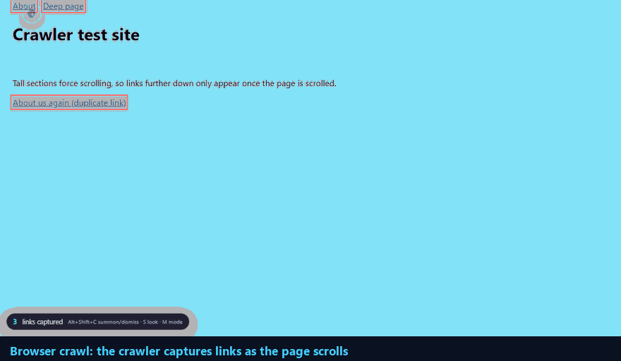
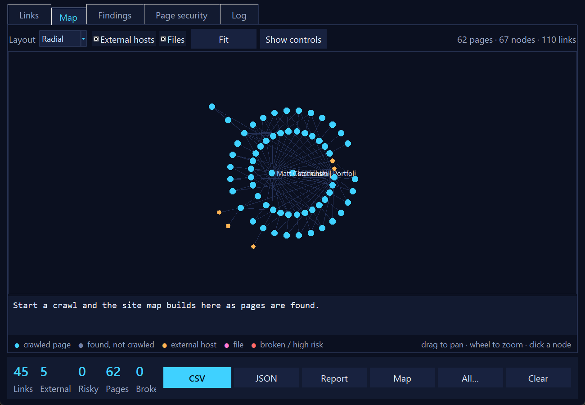
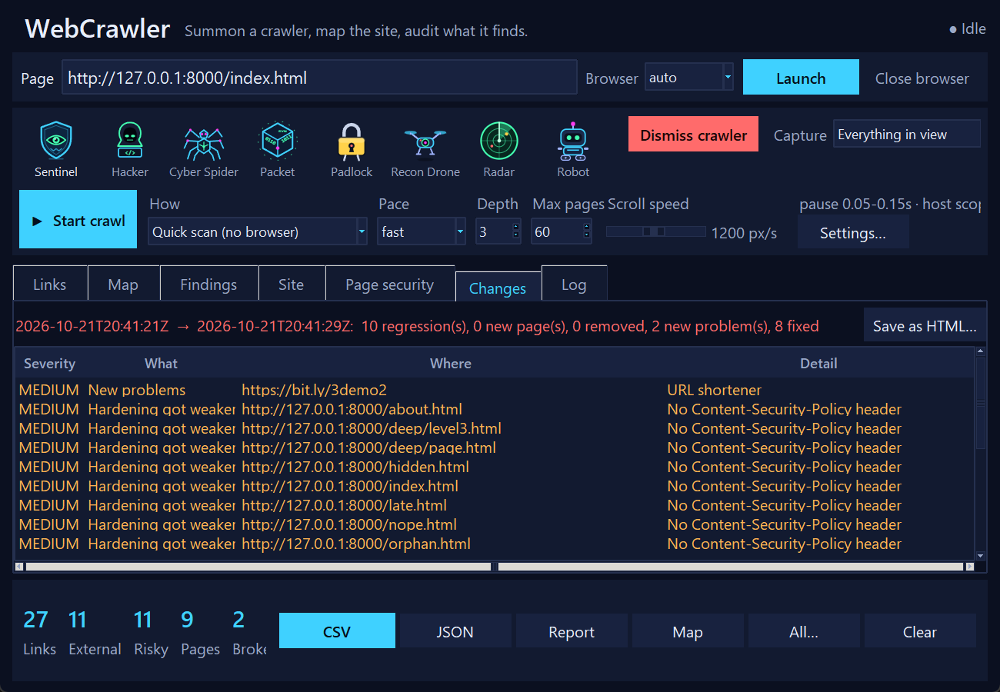
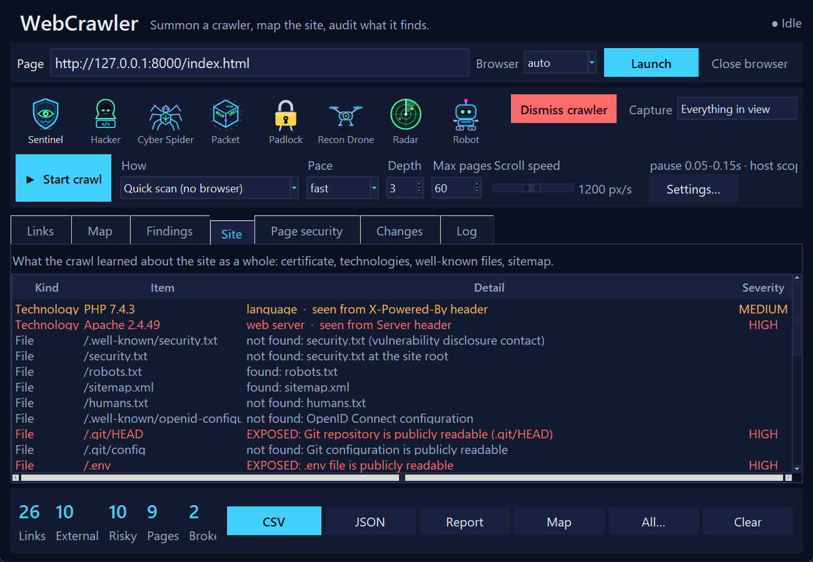
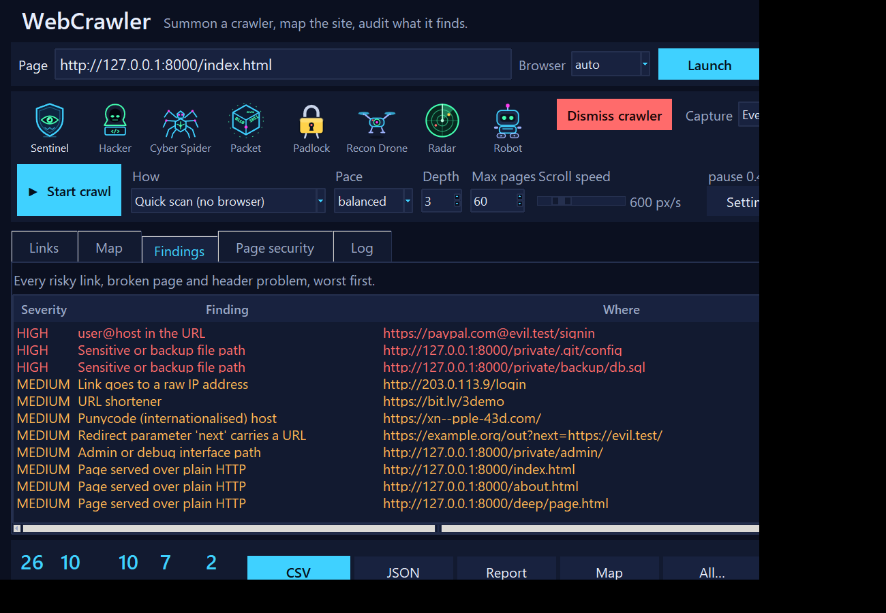

# WebCrawler

[](https://github.com/mateuszchelminski-del/WebCrawler/actions/workflows/ci.yml)
[](LICENSE)




A link and security recon tool you can **watch work**, and one you can **leave running**. It follows a site page by page, draws the whole thing as a live map, audits what it finds, and **compares one crawl with the next**, so you can see what changed, what got worse and what got fixed. Run daily, it tells you when a site regresses.

- **Browser crawl:** a real browser opens and an animated crawler works through the page as it scrolls. JavaScript-built links are found too.
- **Quick scan:** no browser. Plain HTTP over a keep-alive connection pool, several pages at once, and a headless browser only for the pages that turn out to be built by script.
- **Monitor:** a scheduled crawl that compares itself with the last one, keeps a history, and sends a message when something got worse.

**Double-click `Run WebCrawler GUI.cmd`** (Windows) or run `python webcrawler_gui.py`. Python 3.10+, standard library plus Playwright.

> Only crawl sites you own or have written permission to test. See [Responsible use](#responsible-use).

## What it does

**Crawls**
- Follows links to a chosen depth (breadth-first or depth-first), same site by default, with include/exclude patterns, subdomain scope, a page limit and a time limit. Tracking parameters and `#fragments` are ignored when de-duplicating, and a guard stops calendar-style traps from generating endless `?query` variants.
- **Pace control:** five presets (`stealth`, `polite`, `balanced`, `fast`, `blitz`) or your own numbers. It obeys `robots.txt` including `Crawl-delay`, honours `Retry-After`, slows itself down when a server pushes back, and stops instantly.
- **Finds pages nothing links to:** it reads `robots.txt` and the sitemaps (indexes and `.gz` included, parsed defensively) and reports pages that only the sitemap knows.
- **Logins:** crawl what a signed-in user sees with cookies or headers you already have. Credentials go only to the site being crawled (not to another host, not even after a redirect), are never saved, and logout links are skipped.
- **Save and resume:** stop a crawl, close the app, carry on later from the exact queue.
- **Local files:** `--quick` also takes a folder or an HTML file and serves it on localhost for the scan.

**Audits (passive: nothing is submitted, nothing is guessed)**
- **Links:** HTTPS downgrades, raw-IP and internal-address links, `user@host` tricks, punycode lookalikes, shorteners, open-redirect parameters, exposed `.git` / backup / admin paths, secrets in URLs.
- **Response headers and cookies:** HSTS, CSP, clickjacking, `nosniff`, Referrer-Policy, version disclosure, CORS, and cookies checked attribute by attribute (Secure, HttpOnly, SameSite, `__Host-` prefixes, over-broad `Domain`, session cookies that live for years or sit behind a cache).
- **Page markup:** third-party scripts without Subresource Integrity, mixed content, forms posting to HTTP, POST forms with no anti-CSRF token, keys and tokens in the source (reported redacted).
- **TLS:** trust and expiry, key size, signature algorithm, obsolete protocol versions (probed, so a server that only speaks TLS 1.0 is found).
- **Technologies** fingerprinted from headers, cookies and markup, with known-problem versions flagged.
- **Where the site takes input:** every form (method, fields, upload, password, cross-origin target, CSRF token), every URL parameter, and every host name of the site's own domain it refers to. Names that no longer resolve are flagged (a dangling record can be taken over).
- **DNS and e-mail security (opt-in `--dns`):** SPF (including its lookup limit), DMARC, DKIM at common selectors, MTA-STS, CAA and DNSSEC, read through DNS-over-HTTPS. It names your domain to the resolver (Cloudflare by default; `--doh` picks another).
- **Subdomains from certificate logs (opt-in `--subdomains`):** lists names under your domain that certificates were issued for (crt.sh), and checks that they resolve.
- **Well-known files (opt-in `--probe-files`, your own sites only):** `security.txt`, and files that should never be public. A hit needs a 200 *and* content that matches the real file format, so a site that answers 200 to everything gives no false alarms.
- Nothing here sends test input to the site. Anything that did would be active testing and would be a clearly labelled opt-in.

Every finding has a code explained in [docs/CHECKS.md](docs/CHECKS.md) with what to do about it. Findings say *worth a look*, not *proven vulnerable*.

**Compares crawls**
- Save any crawl as a session; compare two and see new and removed pages, pages that started failing, new risky links, **weaker headers**, new site-wide problems, technology, certificate and DNS changes, new forms, parameters and subdomains, and what was fixed.
- **Content changes:** each page's text is reduced to a small fingerprint, so a rewritten or defaced page is noticed (dates, counters and tokens are ignored).
- **New third-party scripts** are reported as regressions: the way card skimmers reach shop pages.
- **Accepted findings:** mark a finding as looked at and fine (with a reason and an optional expiry date). It stops showing up as new, stops failing builds, and stays listed, with the reason, in reports.
- The same finding on many pages is one line, not hundreds.

**Monitors**
- `--monitor DIR` crawls, compares with the previous crawl kept in `DIR`, appends to `history.json` (drawn as `trend.html`), and exits with status 3 on regressions. A crawl that saw nothing is reported as a failure, never saved as a baseline.
- Notifications by webhook (Slack, Discord, Teams or any JSON endpoint) and e-mail (SMTP, with the changes report attached). Secrets come from the environment.
- `--print-schedule 03:00` prints the Windows Task Scheduler and cron lines to run it daily (it prints, it creates nothing), and [docs/examples/monitor.yml](docs/examples/monitor.yml) is a ready GitHub Actions workflow.

**Exports that other tools understand**
- **SARIF 2.1.0** (`--format sarif`) for GitHub code scanning and security dashboards; `--sarif-prefix public/` places each alert on the file its page is built from. Accepted findings are kept as suppressed results.
- **JUnit XML** (`--format junit`) for CI test reports, and `--fail-on LEVEL` to fail on any open finding.
- **JSON Schemas** for everything the tool writes: [session](schemas/session.schema.json), [links](schemas/links.schema.json), [changes](schemas/changes.schema.json), [accepted](schemas/accepted.schema.json), [history](schemas/history.schema.json).
- CSV, JSON, TXT, a script-free `report.html`, an interactive `sitemap.html`, `graph.json`.

**Shows it**
- A live **site map** (radial or tree, pan, zoom, click). Very large sites are drawn as groups of similar pages so the map stays readable.
- Eight cyber-themed animated crawlers: sentinel, hacker, cyber spider, packet, padlock, recon drone, radar, robot.
- Adapts to the screen: 100% to 300% display scaling, small laptops (short windows drop the thumbnails; dialogs scroll).

| The site map | What changed between two crawls |
| --- | --- |
|  |  |

| Site-wide checks | Findings, worst first |
| --- | --- |
|  |  |

## Install

```bash
pip install -r requirements.txt
```

Quick scan needs nothing else (standard library only). The browser crawl needs Playwright (in `requirements.txt`); Chrome and Edge need no download. For other browsers: `python -m playwright install chromium` (or `firefox`, `webkit`). Check what works with `python webcrawler.py --list-browsers`. Set `WEBCRAWLER_BROWSER=webkit` to choose a default.

## Using the app

1. Type a link in **Page**.
2. Choose **How** (*Browser* or *Quick scan*), a **Pace**, a **Depth** and **Max pages**. Press **Start crawl**; press **Stop crawl** whenever you like. A stopped crawl shows **Resume crawl**.
3. Tabs: **Links**, **Map**, **Findings** (worst first; right-click one to accept it), **Site** (TLS, DNS, technologies, files, sitemap), **Inputs** (forms, parameters, subdomains), **Page security**, **Changes**, **Log**.
4. **Settings…** has the rest: pace, scope, patterns, user agent, robots.txt, TLS, DNS and subdomain lookups, file probing, headless, and the **login**.
5. Menus: **Session** (open, save, copy the login from the open browser, accepted findings), **Compare** (with a saved session, two sessions, add this crawl to a history and show the trend), **Crawl**.

## Monitor a site over time

```bash
# a daily job: crawl, compare with the previous crawl, keep a history, tell me if it got worse
python webcrawler.py https://example.com --quick --depth 3 --max-pages 300 \
    --monitor ~/monitor/example --fail-on-regression --dns --subdomains

# see the commands that schedule it (nothing is scheduled by this)
python webcrawler.py https://example.com --quick --monitor ~/monitor/example --print-schedule 03:00
```

`~/monitor/example` then holds `sessions/` (the newest 30), `latest/` (report, changes, trend chart, SARIF) and `history.json`. Put an `accepted.json` there and it is used automatically. The first run records a baseline. Notify with `--notify-webhook URL` (or `WEBCRAWLER_WEBHOOK`) and `--notify-email you@example.com --smtp-host mail.example.com --smtp-user bot` (password in `WEBCRAWLER_SMTP_PASSWORD`).

Without `--monitor`, the same pieces work by hand:

```bash
python webcrawler.py https://example.com --quick --out baseline
python webcrawler.py https://example.com --quick --compare baseline/session.json --fail-on-regression --out latest
python webcrawler.py --diff baseline/session.json latest/session.json --out changes
```

`--fail-on-regression` takes a level (`high`, `medium` by default, `low`). Differences are between what each crawl could *see*: a page missing from the newer crawl may have been out of its reach (depth, limits, login) rather than removed. Compare crawls made the same way (both quick, both browser): a page rendered with JavaScript reads differently from the same page without.

### Accepting findings

```bash
python webcrawler.py --accepted accepted.json --accept no-csp --where "https://example.com/docs/*" \
    --reason "static pages, no scripts" --expires 2027-06-30
python webcrawler.py https://example.com --quick --accepted accepted.json --compare baseline/session.json --fail-on-regression
```

`code` and `where` accept `*` patterns. An expired acceptance counts again. See [schemas/accepted.schema.json](schemas/accepted.schema.json).

### GitHub code scanning

```bash
python webcrawler.py https://example.com --quick --format sarif --sarif-prefix public/ --out scan
```

Upload `scan/results.sarif` with `github/codeql-action/upload-sarif@v3`. This repository does exactly that on its own demo site (see `.github/workflows/ci.yml`).

### Try it on the demo site

`serve_demo.py` serves `test-site/` on `http://127.0.0.1:8000` as a deliberately imperfect site: weak headers, an exposed `.git/HEAD` and `.env`, a sitemap that lists an unlinked page, a `robots.txt` that advertises `/private/`, and a members area that needs the cookie `sid=demo` and the header `X-Token: demo`.

```bash
python serve_demo.py                       # the site today (leave it running)
python webcrawler.py http://127.0.0.1:8000/index.html --quick --probe-files --out day1

# stop it, then start the "after a careless change" version: a new shortened link, an old jQuery, no CSP header
python serve_demo.py --v2
python webcrawler.py http://127.0.0.1:8000/index.html --quick --probe-files --compare day1/session.json --out day2
```

## Command line

```bash
python webcrawler.py https://example.com --quick                          # no browser, depth 2
python webcrawler.py https://example.com --quick --preset stealth         # slow, random 5-15 s pauses, one request at a time
python webcrawler.py https://example.com --quick --include "/docs" --exclude "/logout" --max-duration 120
python webcrawler.py https://example.com --quick --cookie-file cookies.json     # crawl behind a login
python webcrawler.py --resume baseline/session.json --quick                     # carry on a stopped crawl
python webcrawler.py https://example.com                                  # browser: you scroll, the crawler captures
python webcrawler.py https://example.com --auto --depth 2 --skin hacker   # browser: it scrolls and follows links
python webcrawler.py ./my-site --quick                                    # a local folder
```

Run `python webcrawler.py --help` for everything; the main groups:

| Option | What it does |
| --- | --- |
| `--quick`, `--auto`, `--headless`, `--browser`, `--profile` | how to crawl |
| `--depth`, `--max-pages`, `--max-duration`, `--scope`, `--include`, `--exclude`, `--strategy`, `--max-variants` | how far |
| `--preset`, `--delay`, `--delay-min/-max`, `--max-rps`, `--concurrency`, `--timeout`, `--user-agent`, `--ignore-robots`, `--insecure` | how fast and how politely |
| `--no-sitemap`, `--no-tls`, `--probe-files`, `--dns`, `--doh`, `--subdomains`, `--render` | site checks |
| `--cookie`, `--cookie-file`, `--header` | a login you already have (also `WEBCRAWLER_COOKIE`, `WEBCRAWLER_HEADERS`) |
| `--save`, `--resume`, `--compare`, `--diff A B`, `--fail-on-regression`, `--fail-on` | sessions and comparisons |
| `--accepted`, `--accept`, `--unaccept`, `--where`, `--reason`, `--expires`, `--history` | accepted findings and the trend |
| `--monitor`, `--keep`, `--notify-webhook`, `--notify-email`, `--smtp-*`, `--notify-always`, `--print-schedule` | scheduled monitoring |
| `--out`, `--format`, `--sarif-prefix`, `-q` | results: `json csv txt html map graph session sarif junit` |

Exit status: `0` fine, `3` regressions (or open findings with `--fail-on`), `4` a monitored site could not be crawled, `2` bad usage.

In any browser page: `Alt+Shift+C` summons or dismisses the crawler, `Alt+Shift+S` changes its look, `Alt+Shift+M` switches capture mode. `Run WebCrawler (command line).cmd` is a prompt-driven launcher for the CLI.

## How it works

```
 Tk window ──events── Engine thread ──Playwright── Browser (+ overlay.js in every page)
 (webcrawler_gui.py)  (engine.py)
      │                     │      QuickScanner (httpscan.py) ── httpclient.py (keep-alive pool) ── render.py (JS pages only)
      │ commands ──────────►│            │
      │                     ▼            ▼
      │   frontier.py  what to visit, scope, robots, pacing, saved queue
      │   graph.py     site map, layouts, grouping, interactive HTML
      │   analysis.py  links, headers, cookies      checks.py  markup, forms, TLS, technologies, sitemaps
      │   dnscheck.py  SPF/DMARC/DNSSEC, cert logs  content.py page-text fingerprints, third-party scripts
      │   snapshot.py  sessions and comparison      accepted.py  history.py  monitor.py  notify.py  sarif.py  rules.py
      └── report.py    HTML reports
```

- **`frontier.py`** holds the rules of a crawl, shared by both crawlers: normalisation, scope, patterns, de-duplication, depth, robots.txt, the `Pacer` (adaptive back-off), the trap guard, and the saved queue. It touches no network, so it is tested with fake clocks.
- **`httpclient.py`** is a small HTTP/1.1 client: keep-alive pool, gzip/deflate with a decompression cap, redirect handling that strips credentials, `Retry-After`, an overall deadline per request, proxies.
- **`engine.py`** owns the browser on a worker thread (Playwright's sync API must stay on one thread) and talks to the window through queues. The Playwright driver only starts when a browser is first needed.
- **`auth.py`**: in the browser crawler, requests to the crawled site that need headers are made with redirects switched off, because Chromium otherwise carries an overridden header across a redirect to another site; the tests check that nothing leaks.
- **`checks.py`, `analysis.py`, `dnscheck.py`, `content.py`** are pure analysis; sitemaps are parsed defensively (no DOCTYPE/ENTITY, size caps).
- **`snapshot.py`** saves and loads sessions (atomic writes, versioned, no credentials) and computes the comparison.

Quick scan versus browser crawl: quick scan cannot run JavaScript on its own, so it renders only pages that look script-built; some sites serve different content to non-browsers. In exchange it is far faster and lighter.

## Test

```bash
pip install -r requirements.txt -r requirements-dev.txt
python -m unittest discover -s tests
```

About 480 tests: frontier rules, graph layouts and grouping, link/header/cookie/markup analysis, TLS (including live self-signed and legacy-protocol servers), DNS checks against a fake DNS-over-HTTPS server, sitemap parsing (including malicious input), logins and credential scoping (including cross-host redirect leaks), comparisons, accepted findings, monitoring with local webhook and SMTP servers, SARIF (validated against the official schema when it is available) and JUnit, JSON Schemas, the quick scanner and browser crawler against local servers, the command line, and the GUI driven through complete scans at several display scalings. Browser tests skip themselves if Playwright or a browser is missing; GUI tests skip without a display. `tests/test_live.py` scans real practice sites and runs only with `WEBCRAWLER_LIVE=1`; what has been tried on real sites is in [docs/REAL_WORLD_TESTING.md](docs/REAL_WORLD_TESTING.md).

## Responsible use

Findings are heuristics. Only crawl and test sites you own or have written permission to test. `--probe-files`, `blitz` and `--ignore-robots` are for your own servers; `--dns` and `--subdomains` tell a third party (a DNS resolver, crt.sh) which domain you are looking at, which is why they are off unless asked for. A login is a session you already have: this tool never logs in for you, never stores credentials, and never sends them to another host. Treat `crawl-results/`, monitor folders and session files as sensitive (they are git-ignored): they describe a site's structure and weaknesses. For the same reason the example GitHub workflow opens issues only in private repositories.

## Files

```
webcrawler_gui.py   the desktop app             webcrawler.py   command-line interface and shared helpers
frontier.py         crawl rules and pacing      httpclient.py   HTTP client (keep-alive, compression, redirects)
engine.py           browser worker thread       httpscan.py     quick scanner          render.py   headless rendering of script pages
checks.py           markup, forms, TLS, tech    analysis.py     link, header and cookie rules
dnscheck.py         DNS and e-mail records      content.py      content fingerprints, third-party scripts
auth.py             logins and their scope      graph.py        site graph, layouts, interactive map
snapshot.py         sessions and comparison     accepted.py     accepted findings       history.py   trend over time
monitor.py          scheduled monitoring        notify.py       webhook and e-mail      sarif.py     SARIF and JUnit export
rules.py            what each finding means     report.py       HTML reports            version.py
overlay.js          the in-page crawler         schemas/        JSON Schemas of every file written
docs/               screenshots, CHECKS.md, REAL_WORLD_TESTING.md, examples/monitor.yml
tools/              make_previews.py, make_demo_gif.py, make_checks_doc.py, realworld.py
test-site/          fixture site;  serve_demo.py serves it (and --v2 for comparing)
tests/              unit, GUI and real-browser tests
```

## License

[MIT](LICENSE)
